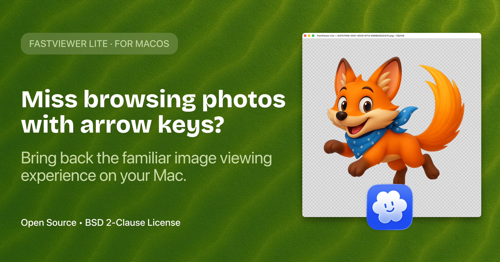
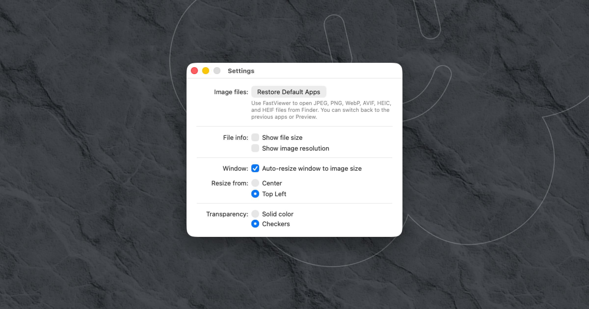

# FastViewer Lite

Browse images with the arrow keys.

If you’ve switched from Windows, Linux or FreeBSD, you may miss being able to open a photo and move through the rest of the folder. Preview on macOS can make that harder than it needs to be.

FastViewer Lite lets you open an image and browse the folder with the left and right arrow keys. It’s a quick, simple viewer that keeps the focus on your images.

Open a picture and start browsing.

### Why FastViewer Lite?

- Browse a folder with the arrow keys.
- Move between images with ← and →. You don’t need to select multiple files in Finder first.
- Quick to open, light on features you don’t need.
- A minimal native macOS viewer for opening images quickly, without a full photo editor.
- A native macOS app inspired by feh’s simplicity on FreeBSD.
- Free and open source
- Released under the BSD 2-Clause License.

### Download

[Download FastViewer Lite 3.4](https://github.com/alexdeplov/FastViewer-Lite-for-macOS/raw/refs/heads/main/Build/FastViewer%20Lite%203.4.zip) (macOS 14 Sonoma or later).
